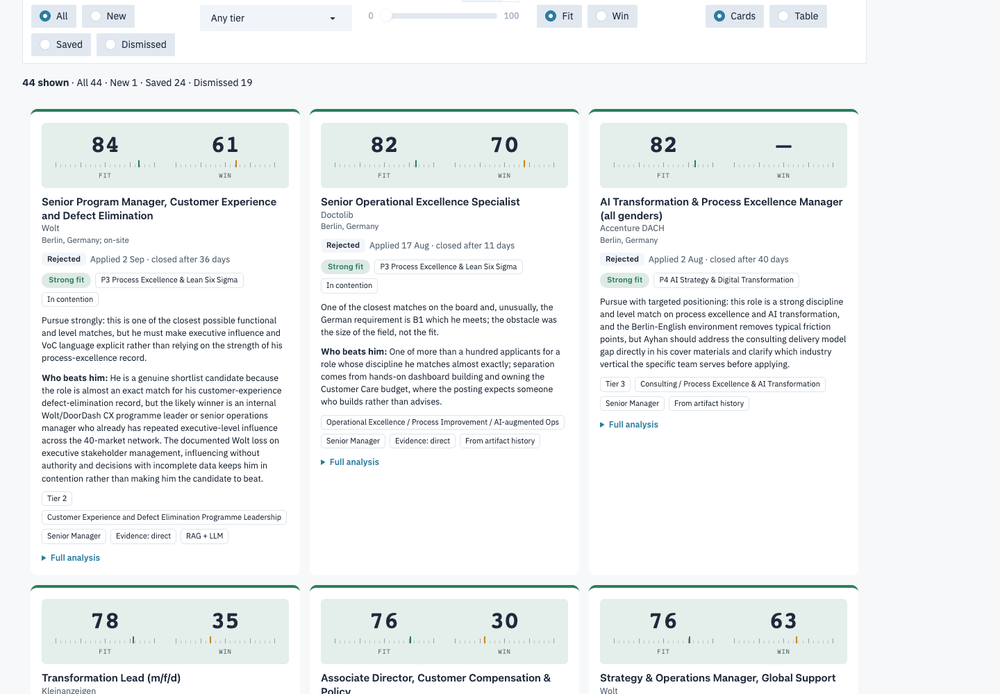
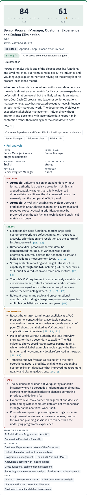
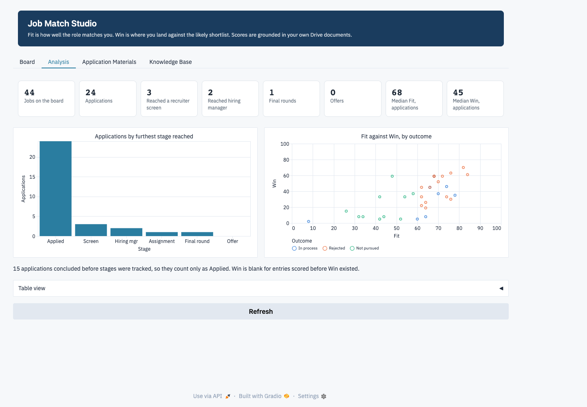
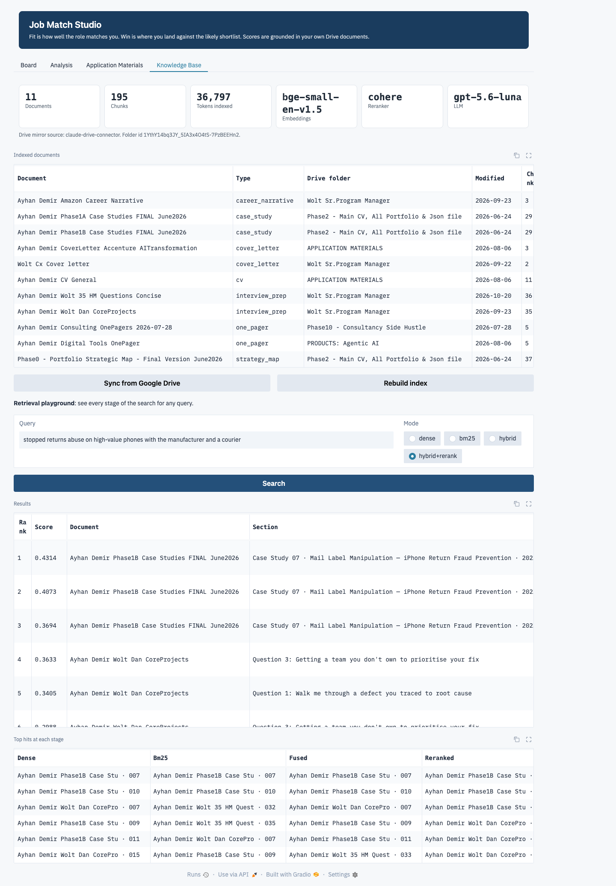

# Job Match Studio

A Gradio app that scores job postings against my own career documents. It merges two tools I built in Claude chat and adds a retrieval layer over my Google Drive project folder.

| Source | What it contributes |
|---|---|
| Lovable app *Job Search & Match Score Pro* | Layout and formatting: Board, Analysis and Application Materials tabs, Fit/Win gauge cards, pipeline stages, canonical facts and drafting rules for the CV and cover letter |
| Claude artifact *Job Match Board* | Scoring logic: candidate profile, outcome calibration, the Fit vs Win rubric, the offline keyword scorer, the LinkedIn search launcher, and 43 scored jobs with real outcomes |
| New here | RAG over the Drive folder, outcome-calibrated few-shot prompting, rubric guardrails in code, self-checking materials, Gradio UI |

**Fit** is how well the role matches the candidate. **Win** is where he lands against the likely shortlist. The two are scored separately because the artifact's own history showed that a strong fit says little about winning.

| Board | Card back | Analysis | Knowledge Base |
|---|---|---|---|
|  |  |  |  |

## How it works

```
Google Drive folder ──drive_sync.py──▶ data/drive  (mirror + manifest.json)
        │ ingest.py: parse → canonicalise → section-aware chunks → contextual headers → project/pillar tags
        ▼
 Chroma vector DB (local bge-small embeddings)  +  BM25 keyword index
        │ rag.py, per requirement: dense ×2 + BM25 ×2 (wording + HyDE query) → RRF → rerank → authority prior → dedupe → token budget
        ▼
 posting → decompose (LLM) → evidence pack [E1..En] → 3 most similar past jobs with real outcomes → rubric prompt
        → Structured Output (evidence fields first, scores last) → guardrails + sanitiser → SQLite board → Gradio UI
                                                     └→ materials.py: CV + cover letter → 11 rule checks → one self-repair round → .docx
```

### Retrieval, tailored to a career portfolio

- **Canonicalisation at ingest.** The canonical record outranks the source documents. Mentions of the excluded project are removed at the smallest unit: a sentence, a table row, or a whole table when its title row is about it. Titles the record forbids are rewritten. Retrieval can therefore never surface a claim the candidate has ruled out.
- **Section-aware chunks** (about 320 tokens) follow the documents' own structure: case study › subsection, interview question, table rows with the header repeated. Each chunk is embedded with a contextual header such as `[Case Studies › Case Study 02 · Concession Permission Clean-Up › Results]`.
- **Local embeddings** (`BAAI/bge-small-en-v1.5` on the Mac's GPU): the documents never leave the machine for indexing.
- **Hybrid search.** Dense vectors and BM25 are fused with Reciprocal Rank Fusion, so exact figures and acronyms ($132M, BUWG) and paraphrases both match.
- **Requirement-level multi-query with HyDE.** Each requirement is searched by its own wording and by a sentence describing what proof would look like in a CV.
- **Reranking** with Cohere `rerank-v3.5`, falling back to a local cross-encoder. Primary documents (CV, case studies) get a small boost over restatements such as interview prep.
- **Evidence hygiene.** Near-duplicates are dropped, each document is capped, the pack fits a token budget, and cover letters are excluded from evidence because they echo the posting they were written for. They serve as style examples instead.

### Prompting

- **Layered system prompt**, verbatim from the artifact: profile, outcome calibration, Fit/Win rubric.
- **Dynamic few-shot.** The model sees the 3 most similar past assessments with their scores and what actually happened (rejected, final round, not pursued). Leave-one-out: it never sees its own earlier verdict on the same role.
- **Structured Outputs** (Pydantic). The field order makes the model write requirement verdicts, strengths, gaps and blockers, each citing `[E#]` evidence, before it writes Fit and Win.
- **Guardrails in code.** A hard screen caps Win at 25, Fit of 85+ allows at most one gap, and non-direct evidence caps Win at 70. Invented citations are dropped, and level codes, the excluded project and the "VP" title are stripped.
- **Materials.** Drafts are grounded in the canonical record plus the job's evidence pack and styled on the most similar real cover letter (metadata-filtered search). They are checked against 11 rules: length, no dashes, banned phrases, every number in the sources, each locked figure with its own project, and others. One self-repair round runs if a rule fails.

## Run it

```bash
conda activate bootcamp-env            # Python 3.11
cd job-search-score-apply-bot
pip install -r requirements.txt
export OPENAI_API_KEY=...  COHERE_API_KEY=...   # session only; or put them in ~/.config/job-search-bot/.env
python ingest.py                        # builds data/chroma from data/drive
python app.py                           # http://127.0.0.1:7860
```

Without an OpenAI key the app still runs: scoring falls back to the artifact's offline keyword scorer, and retrieval uses the local reranker.

**Refreshing from Google Drive.** `drive_sync.py` mirrors the whole folder through the Drive API (read-only). It keeps the newest version of each document and skips images, code exports, backups and oversized scans. One-time setup: in Google Cloud Console, enable the Drive API, create an OAuth client of type *Desktop app*, and save it here as `credentials.json`. Then run `python drive_sync.py` (a browser opens once for consent) and `python ingest.py`, or use the buttons in the Knowledge Base tab. The current mirror was pulled through Claude's Google Drive connector, in the same format.

## Files

| File | Role |
|---|---|
| `app.py` | Gradio UI: Board, Analysis, Application Materials, Knowledge Base |
| `assess.py` | The pipeline: decompose, retrieve, calibrate, assess, guard |
| `rag.py` | Hybrid retrieval, RRF, reranking, evidence pack |
| `ingest.py` | Loaders (md, docx, pdf, pptx, json), canonicalisation, chunking, indexing |
| `drive_sync.py` | Google Drive API mirror with version de-duplication |
| `materials.py` | CV and cover letter drafting, rule checks, self-repair, .docx export |
| `scoring.py` | Offline scorer, guardrails, sanitiser |
| `store.py` | SQLite job board, history import, funnel |
| `candidate.py` | Profile, calibration, rubric, canonical facts, keyword buckets, tiers |
| `llm.py`, `ui.py`, `config.py` | OpenAI structured-output calls, HTML and CSS, settings |
| `quality_check/` | [`lab_proof.ipynb`](quality_check/lab_proof.ipynb) (executed proof of every step, 60 checks), [`LAB_PROOF.md`](quality_check/LAB_PROOF.md) (summary), `screenshots/` |

## Data and privacy

Everything personal stays in `data/` (gitignored): the Drive mirror, the vector database, the job board, the history export and the drafts. API keys are read from the environment or from `~/.config/job-search-bot/.env`, outside the project folder (set `JOB_BOT_ENV_FILE` to use another path). The notebook checks that no key value appears in any project file. The notebook outputs, `LAB_PROOF.md` and the screenshots in `quality_check/` quote career details, so review them before pushing to a public repository.
