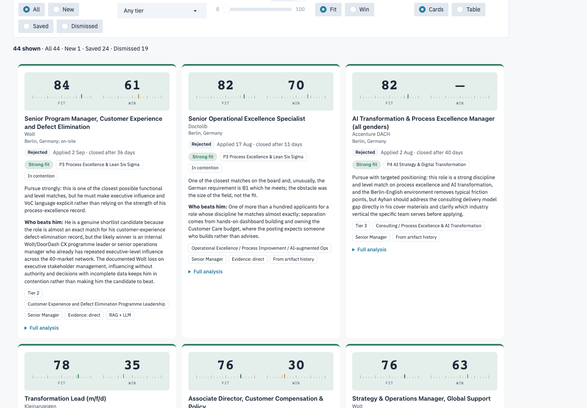
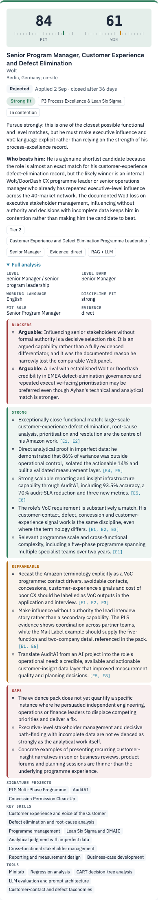
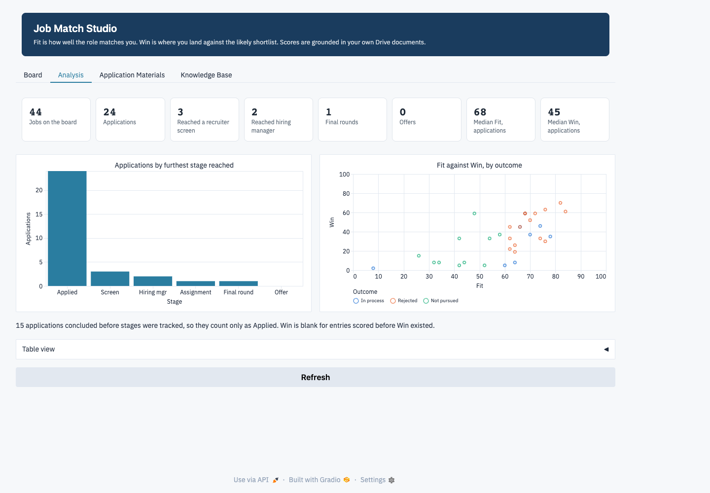
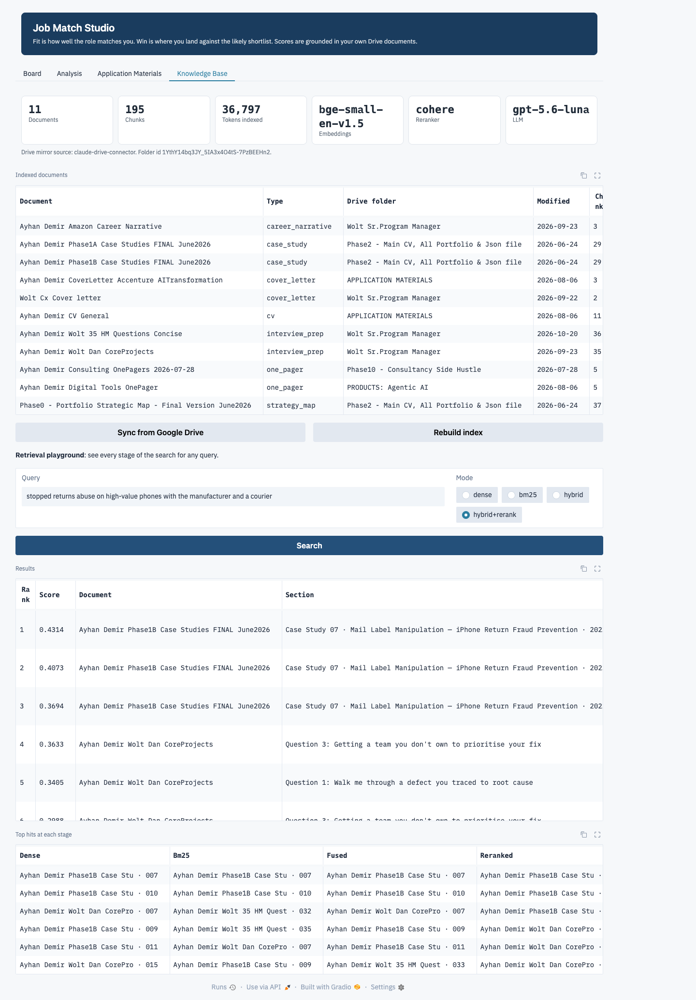

# Lab proof · Job Match Studio

Executed notebook: [`lab_proof.ipynb`](lab_proof.ipynb) · run 2026-11-06 15:29 · 2.9 min ·
LLM `gpt-5.6-luna` (decomposition `gpt-5.4-mini`) · embeddings `BAAI/bge-small-en-v1.5` (local) · reranker `cohere`

**Result: 60 / 60 checks passed.**

## Checks

| Step | Check | Result | Evidence |
|---|---|---|---|
| 0 Setup | OpenAI key available to this run (value never printed) | PASS |  |
| 0 Setup | Cohere key available, so reranking uses rerank-v3.5 | PASS | cohere |
| 0 Setup | Keys come from the environment, not from a file in the project | PASS |  |
| 1 Drive | Core project documents mirrored from Google Drive | PASS | 11 documents, 179,226 characters |
| 1 Drive | Every mirrored document has text | PASS | smallest has 1,924 characters |
| 1 Drive | Each document links back to its Drive file | PASS |  |
| 1 Drive | Sync keeps only the newest version of each document | PASS | 3 of 12 kept |
| 1 Drive | Sync skips backups, copies, images, code exports and oversized scans | PASS |  |
| 2 Canonicalise | Excluded project (ACES AI Strategy) removed from the index | PASS | 16 mentions in the Phase 0 map, 0 in the index |
| 2 Canonicalise | Canonical title enforced (no 'VP' for the wellbeing role) | PASS | 10 rewrites |
| 2 Canonicalise | Redaction is surgical: the 60-row project map survives | PASS | 11 project-map chunks kept |
| 3 Chunking | Chunks fit the 320-token budget | PASS | max 320, median 195 |
| 3 Chunking | Every chunk has a contextual header and a Drive link | PASS |  |
| 3 Chunking | Case-study structure preserved (document › case study › subsection) | PASS |  |
| 3 Chunking | Table pieces repeat the header row | PASS |  |
| 3 Chunking | Most chunks tagged with a signature project | PASS | 157 of 195 |
| 4 Vector DB | Chroma holds one vector per chunk | PASS | 195 vectors |
| 4 Vector DB | Vectors are normalised for cosine search | PASS |  |
| 5 Retrieval | Dense, BM25, fusion and rerank stages all return results | PASS |  |
| 6 Retrieval eval | On paraphrased queries, dense search beats BM25 (semantic search earns its place) | PASS | MRR@5 0.944 vs 0.87 |
| 6 Retrieval eval | The app's default (Hybrid + Cohere rerank-v3.5) has the best MRR@5 on paraphrased queries | PASS | 1.0 |
| 6 Retrieval eval | The default finds the right project in the top 3 for at least 90% of all 21 queries | PASS | Hit@3 1.0 |
| 7 Decompose | Posting broken into 4 to 7 prioritised requirements | PASS | 6 requirements |
| 7 Decompose | Each requirement has a HyDE-style evidence query | PASS |  |
| 7 Decompose | No German requirement found in an English-only posting | PASS |  |
| 8 Evidence | Every critical requirement has retrieved evidence | PASS | 4 critical requirements |
| 8 Evidence | Evidence fits the 3200-token budget | PASS | 1771 tokens in 8 chunks, 9.9s |
| 8 Evidence | Cover letters excluded from evidence (style examples only) | PASS |  |
| 8 Evidence | Evidence drawn from several documents, including primary ones | PASS | 5 documents |
| 9 Few-shot | Three outcome-labelled examples selected by similarity | PASS |  |
| 9 Few-shot | Leave-one-out: the same Wolt role is never shown to the model | PASS |  |
| 10 Prompt | Prompt carries calibration, examples, requirements, cited evidence and the job text | PASS |  |
| 10 Prompt | Prompt stays compact | PASS | 6,237 tokens |
| 11 Assess | Full RAG + LLM pipeline ran (not the offline fallback) | PASS | 32.7s · {'decompose': 4.1, 'retrieve+examples': 4.4, 'assess': 24.1, 'total': 32.7} |
| 11 Assess | Fit and Win are valid 0-100 scores | PASS | fit 84, win 54 |
| 11 Assess | Every requirement received a verdict | PASS |  |
| 12 Grounding | Every cited evidence id exists in the pack | PASS |  |
| 12 Grounding | At least 80% of strong and reframeable points cite evidence | PASS | 10/10 cited |
| 12 Guardrails | German requirement adds a screen that caps Win at 25; 85+ Fit needs at most one gap | PASS |  |
| 12 Guardrails | Non-direct evidence caps Win at 70 and invented citations are dropped | PASS |  |
| 12 Guardrails | Sanitiser strips level codes, the excluded project and the VP title | PASS |  |
| 13 Calibration | Fit agrees with the original board within 10 points | PASS | 84 vs 86 |
| 13 Calibration | Win respects the posting-only ceiling (≤ 70) | PASS | win 54; the board's 78 came after a final round |
| 14 Negative control | Software-engineering role with C2 German gets a low Fit | PASS | fit 4 |
| 14 Negative control | Hard screens hold Win at 25 or below | PASS | win 2 |
| 14 Negative control | German requirement recognised as a screen | PASS |  |
| 15 Fallback | Offline scorer works without any LLM | PASS |  |
| 15 Fallback | Offline scorer still ranks the right role above the negative control | PASS | 42 vs 0 |
| 16 Board DB | All 43 artifact jobs are on the board | PASS | 44 jobs on the board |
| 16 Board DB | Re-scoring Wolt updated its existing row and kept its stage | PASS | id j1hmn0gk · saved / rejected |
| 16 Board DB | New assessments are stored with their RAG trace | PASS | 11 evidence chunks stored |
| 17 Materials | Cover letter and CV drafted | PASS |  |
| 17 Materials | Final draft passes every drafting rule | PASS | 11/11 rules |
| 17 Materials | Word files exported | PASS | Ayhan_Demir_CV_Wolt_Senior_Program_Manager, Ayhan_Demir_CoverLetter_Wolt_Senior_Progra |
| 18 App | Gradio app builds and serves its API | PASS | /analysis, /draft, /kb_search, /linkedin, /rebuild_index, /score, /update_job |
| 18 App | Knowledge-base search works through the UI | PASS |  |
| 18 App | LinkedIn launcher builds a Berlin, newest-first search | PASS |  |
| 18 App | Score & add works through the UI and returns a job card | PASS |  |
| 19 Security | No API key value in any project file | PASS | 33 files scanned |
| 19 Security | Personal data, the database and secrets are gitignored | PASS |  |

## Retrieval evaluation (21 labelled queries: 12 keyword-rich, 9 paraphrased)

| Query set | Configuration | Hit@1 | Hit@3 | MRR@5 | Precision@5 |
|---|---|---|---|---|---|
| Keyword-rich | Dense only (bge-small) | 0.92 | 1.0 | 0.958 | 0.92 |
| Keyword-rich | BM25 only | 1.0 | 1.0 | 1.0 | 0.98 |
| Keyword-rich | Hybrid (RRF) | 1.0 | 1.0 | 1.0 | 0.98 |
| Keyword-rich | Hybrid + local cross-encoder | 1.0 | 1.0 | 1.0 | 1.0 |
| Keyword-rich | Hybrid + Cohere rerank-v3.5 | 1.0 | 1.0 | 1.0 | 1.0 |
| Paraphrased | Dense only (bge-small) | 0.89 | 1.0 | 0.944 | 0.84 |
| Paraphrased | BM25 only | 0.78 | 1.0 | 0.87 | 0.8 |
| Paraphrased | Hybrid (RRF) | 0.89 | 1.0 | 0.926 | 0.84 |
| Paraphrased | Hybrid + local cross-encoder | 0.89 | 0.89 | 0.917 | 0.84 |
| Paraphrased | Hybrid + Cohere rerank-v3.5 | 1.0 | 1.0 | 1.0 | 0.91 |

## Real posting: Wolt, Senior Program Manager CX and Defect Elimination

- This pipeline: **Fit 84 · Win 54** · evidence direct · strong discipline fit
- Artifact board, scored after the final round: Fit 86 · Win 78 · outcome: applied, rejected after reaching panel / final
- Who beats him: He is a strong substantive match and would likely be read seriously or shortlisted, with direct evidence on defect elimination, imperfect data and cross-functional delivery. However, this is a deep pool for a Wolt senior programme role, and his prior Wolt final-round loss on executive stakeholder management, influencing without authority and incomplete-data decisiveness is directly relevant. A candidate already running defect elimination in food delivery or a two-sided marketplace, especially one with visibly stronger executive presence, is the specific profile most likely to beat him.
- Recommendation: Pursue strongly, but treat it as a competitive re-application: the functional fit is excellent, while the application and interviews must explicitly close the marketplace-context and executive-influence concerns that previously separated him from the winner.

| Req | Verdict | Evidence | Note |
|---|---|---|---|
| R1 | direct | E1, E3 | He has owned global post-delivery defect areas and describes the end-to-end method of identifying, prioritisin |
| R2 | direct | E3, E4 | Eight years in Amazon Customer Experience and operations translating contacts, defects, concessions and fraud  |
| R3 | adjacent | E1, E3, E4 | His career is built around Voice of the Customer through contact drivers, defect elimination and customer-supp |
| R4 | direct | E5, E6 | He built conservative, finance-validated cases from directional data and used regression, CART and labelled-co |
| R5 | direct | E7, E8 | He influenced five internal teams plus Apple and DHL without formal authority and secured concrete controls th |
| R6 | direct | E9, E10 | He created an adopted value framework used in investment decisions and rebuilt inaccurate reporting used by le |
| R7 | adjacent | E6, E10, E11 | He has materially improved measurement, reporting and audit infrastructure, including a 93.5%-accurate tool an |

## Negative control (embedded software, C2 German, on-site Stuttgart)

Fit 4 · Win 2 · screens: The posting explicitly requires at least five years of hands-on embedded development in C/C++, AUTOSAR and MISRA; there is no supporting evidence.; Verhandlungssichere/C2 German is explicitly required, while the candidate has German at B1+.; The degree screen specifies Computer Science or Electrical Engineering; the candidate holds Mechanical Engineering.; The role requires daily programming, embedded software architecture, drivers and HIL testing, all of which are outside his demonstrated discipline.; The Stuttgart on-site arrangement conflicts with his Berlin-based location preference unless relocation is acceptable.

## Application materials checks

| check | pass | detail |
|---|---|---|
| Cover letter is 250 to 330 words | True | 303 words |
| No em or en dashes | True |  |
| No banned phrases | True |  |
| Excluded project never mentioned | True |  |
| No 'VP' for the wellbeing role | True |  |
| $2.1B / $8B only with analysis verbs | True |  |
| Every number is in the sources | True |  |
| Each locked figure sits with its own project | True |  |
| At most 4 roles, 5 bullets each | True | 3 roles |
| Education populated | True |  |
| Employer choice explained first in notes | True |  |

## LLM calls in this run

| model | schema | input_tokens | output_tokens | seconds |
|---|---|---|---|---|
| gpt-5.4-mini | Posting | 1432 | 537 | 4.1 |
| gpt-5.4-mini | Posting | 1432 | 555 | 4.1 |
| gpt-5.6-luna | Assessment | 7252 | 2015 | 24.1 |
| gpt-5.4-mini | Posting | 597 | 572 | 4.0 |
| gpt-5.6-luna | Assessment | 6843 | 1466 | 18.2 |
| gpt-5.6-luna | Materials | 6161 | 1977 | 18.4 |
| gpt-5.4-mini | Posting | 597 | 429 | 3.1 |
| gpt-5.6-luna | Assessment | 6084 | 1444 | 17.5 |

## Screenshots of the running app

Captured from the live Gradio app (Playwright driving Chrome).

| Board: Fit/Win gauge cards | Card back: full analysis with cited evidence |
|---|---|
|  |  |

| Analysis tab | Knowledge Base tab: retrieval playground |
|---|---|
|  |  |

## Reproduce

```bash
conda activate bootcamp-env && cd job-search-score-apply-bot
export OPENAI_API_KEY=...  COHERE_API_KEY=...   # never stored in a file
python -m jupyter nbconvert --to notebook --execute quality_check/lab_proof.ipynb --inplace
```
